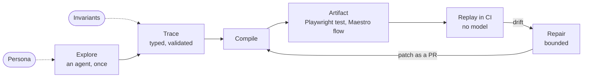

# Explore-Compile-Replay (ECR)

**Let an agent explore your system once. Compile what it did into a standard test. Replay it in CI with no model.**

> **Status: early draft, opened on 24 November 2026.** The contract is being written in the open. Nothing here runs yet. What exists today is listed [below](#what-exists-today).

LLM agents are good at finding what nobody thought to test. They are also slow, they cost money on every run, and they never take the same path twice. That makes them a poor fit for CI.

Explore-Compile-Replay is a pattern that keeps the first property and removes the others:

1. **Explore.** An agent plays a persona and uses the system once. Each action and each check is recorded in a typed trace.
2. **Compile.** The trace becomes a standard artifact: a Playwright test, a Maestro flow. It is a plain file you can read, review and run without ECR.
3. **Replay.** The artifact runs in CI. No model, no tokens, the same verdict every time.

When the system changes and a replay breaks, a bounded **repair** step proposes a patch as a pull request. It may fix how a step finds its target. It may never change what the test checks: if a check fails, a person decides whether it is a regression or an intended change.



## The contract

An adapter connects ECR to one kind of system: a web app, a mobile app, an API. It is three small pieces, not one large interface.

A sketch of what an adapter will look like. Nothing is published on npm yet.

```ts
import { defineAdapter } from "explore-compile-replay";

export default defineAdapter({
  id: "my-system",

  // 1. Two typed vocabularies: what an agent may do, what a test may check.
  actions, // e.g. tap, type, navigate
  oracles, // e.g. visible, equals. Deterministic checks, stored as data.

  // 2. A driver for the live system. Used to explore and to repair, never to replay.
  driver: {
    capabilities: { snapshot: true },
    setup, teardown,
    observe, // the state, and whether it is stable yet
    execute, // one action
    verify,  // one oracle, with no model call
    snapshot, restore,
  },

  // 3. One target per artifact format. It compiles, then runs the native tool.
  targets: [
    {
      id: "playwright",
      compile, // pure: trace in, file and source map out
      replay,  // runs the file, reports typed divergences
    },
  ],
});
```

The draft types are in [`spec/contract.ts`](spec/contract.ts) and the data shapes in [`spec/schema.ts`](spec/schema.ts). An example trace is in [`spec/examples/`](spec/examples/).

## Seven laws

An adapter is correct when it obeys seven laws. A conformance kit will check them, so that anyone can write an adapter and prove it works. Full text: [`spec/laws.md`](spec/laws.md).

| | Law | In short |
|---|---|---|
| L1 | Determinism | The same trace compiles to the same bytes. The same artifact gives the same verdict. |
| L2 | Fidelity | The artifact runs the actions and checks the oracles of the trace, in the same order. |
| L3 | Traceability | Each step of the trace maps to one distinct range of the artifact. |
| L4 | No model | Compiling and replaying call no model. |
| L5 | State | `restore(snapshot())` brings back an identical observed state, when the adapter declares it. |
| L6 | Safe repair | A patch stays inside the range of the failing step, and removes or weakens no oracle. |
| L7 | No secret | Neither the trace nor the artifact contains a secret value. |

## Design choices

- **The artifact is a standard file.** If you stop using ECR, your tests still run.
- **No built-in LLM loop.** Exploring is done by the agent you already use, through an MCP server and skills. ECR records, validates and compiles.
- **The core will never import an LLM SDK.** A replay cannot call a model by accident.
- **Oracles are data.** Every target can emit them, and a repair can prove it removed none.

## What exists today

| Part | Status |
|---|---|
| Trace schema, [`spec/schema.ts`](spec/schema.ts) | Draft. Type-checked, with a validated example |
| Adapter contract, [`spec/contract.ts`](spec/contract.ts) | Draft. Type-checked |
| Seven laws, [`spec/laws.md`](spec/laws.md) | Draft |
| Core, `ecr` command, MCP server | Not started |
| Reference adapter (in memory) and conformance kit | Next |
| Mobile adapter, compiling to Maestro flows | Planned |
| Web adapter, compiling to Playwright tests | Planned |
| Drift benchmark: does a replay break, repair, or stay red when it should? | Planned |
| Paper | Planned |

To check the draft yourself: `pnpm install && pnpm check`.

## Roadmap

These are targets, not promises.

| When | What |
|---|---|
| Week of 24 November 2026 | The contract in the open: schema, adapter contract, laws |
| Week of 1 December | Core, reference adapter, conformance kit. First real adapter: mobile, with Maestro |
| Week of 8 December | Web adapter with Playwright, drift benchmark, version 0.1 |
| After | A real app as a case study, more adapters, a paper |

## Prior art

ECR does not claim to be first. Several tools already keep or replay what an agent did, each for its own system: [Stagehand](https://github.com/browserbase/stagehand), [Skyvern](https://github.com/Skyvern-AI/skyvern), [workflow-use](https://github.com/browser-use/workflow-use), [Midscene](https://github.com/web-infra-dev/midscene), [Arbigent](https://github.com/takahirom/arbigent), [muscle-mem](https://github.com/pig-dot-dev/muscle-mem) and [autocompile](https://github.com/mirkokiefer/autocompile).

What this project adds is a name for the pattern and a written contract for it: one that works across systems, compiles to files that run without the tool, protects what the tests check, and can be verified by a conformance kit.

## Where it comes from

ECR generalizes [mobile-agent-testers](https://github.com/pierridotite/mobile-agent-testers), where AI testers explore a mobile app in parallel and report bugs. Two of its runs never take the same path. ECR is the missing half: keep the path that found the bug, as a test that runs for free.

## Feedback

The contract is the thing to challenge right now. If you maintain a test tool or an agent framework, or if you would write an adapter, open an issue and say what would not fit your system.

## License

[Apache-2.0](LICENSE)
