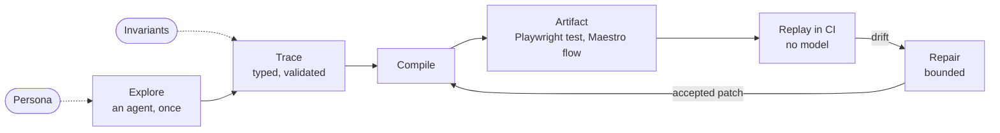

# Explore-Compile-Replay (ECR)

<a href="https://discord.gg/WuaCANscr8"><picture><source media="(prefers-color-scheme: dark)" srcset="assets/discord-join-dark.svg"></picture></a>

**Let an agent explore your system once. Compile what it did into a standard test. Replay it in CI with no model.**

> **Status: early draft, opened on 24 November 2026.** The contract is being written in the open. A first slice runs end to end on a toy system, and compiled flows replay on an Android emulator against a demo app. No real app is supported yet. What exists today is listed [below](#what-exists-today).

LLM agents are good at finding what nobody thought to test. They are also slow, they cost money on every run, and they never take the same path twice. That makes them a poor fit for CI.

Explore-Compile-Replay is a pattern that keeps the first property and removes the others:

1. **Explore.** An agent plays a persona and uses the system once. Each action and each check is recorded in a typed trace.
2. **Compile.** The trace becomes a standard artifact: a Playwright test, a Maestro flow. It is a plain file you can read, review and run without ECR.
3. **Replay.** The artifact runs in CI. No model, no tokens, the same verdict every time.

When the system changes and a replay breaks, your agent proposes a new action for the step that broke, and a bounded **repair** decides whether to accept it. A patch may fix how a step finds its target. It may never change what the test checks: if a check fails, a person decides whether it is a regression or an intended change.



## The contract

An adapter connects ECR to one kind of system: a web app, a mobile app, an API. It is three small pieces, not one large interface.

A sketch of what an adapter will look like. Nothing is published on npm yet.

```ts
import { defineAdapter } from "explore-compile-replay";

export default defineAdapter({
  id: "my-system",

  // 1. Two typed vocabularies: what an agent may do, what a test may check.
  actions, // e.g. tap, type, navigate
  oracles, // e.g. visible, equals. Deterministic checks, stored as data.

  // 2. A driver for the live system. Used to explore and to repair, never to replay.
  driver: {
    capabilities: { snapshot: true },
    setup, teardown,
    observe, // the state, and whether it is stable yet
    execute, // one action
    verify,  // one oracle, with no model call
    snapshot, restore,
  },

  // 3. One target per artifact format. It compiles, then runs the native tool.
  targets: [
    {
      id: "playwright",
      compile, // pure: trace in, file and source map out
      replay,  // runs the file, reports typed divergences
    },
  ],
});
```

The draft types are in [`spec/contract.ts`](spec/contract.ts) and the data shapes in [`spec/schema.ts`](spec/schema.ts). An example trace is in [`spec/examples/`](spec/examples/).

## Seven laws

An adapter is correct when it obeys seven laws. A conformance kit checks them, so that anyone can write an adapter and prove it works. The kit covers six laws today and part of the seventh, and says which part. Full text: [`spec/laws.md`](spec/laws.md).

| | Law | In short |
|---|---|---|
| L1 | Determinism | The same trace compiles to the same bytes. The same artifact gives the same verdict. |
| L2 | Fidelity | The artifact runs the actions and checks the oracles of the trace, in the same order. |
| L3 | Traceability | Each step of the trace maps to one distinct range of the artifact. |
| L4 | No model | Compiling and replaying call no model. |
| L5 | State | `restore(snapshot())` brings back an identical observed state, when the adapter declares it. |
| L6 | Safe repair | A patch stays inside the range of the failing step, and removes or weakens no oracle. |
| L7 | No secret | Neither the trace nor the artifact contains a secret value. |

## Design choices

- **The artifact is a standard file.** If you stop using ECR, your tests still run.
- **No built-in LLM loop.** Exploring is done by the agent you already use, through an MCP server and skills. ECR records, validates and compiles.
- **The core will never import an LLM SDK.** A replay cannot call a model by accident.
- **Oracles are data.** Every target can emit them, and a repair can prove it removed none.
- **A bug is a test too.** When the agent finds something wrong, the check that should hold is recorded as failed. It compiles to a test that is red until the bug is fixed.

## What exists today

| Part | Status |
|---|---|
| Trace schema, [`spec/schema.ts`](spec/schema.ts) | Draft. Type-checked, with a validated example and a generated [JSON Schema](spec/trace.schema.json). A step may carry evidence (a screenshot, where the finger landed) for tools that show a trace |
| Adapter contract, [`spec/contract.ts`](spec/contract.ts) | Draft. Type-checked |
| Seven laws, [`spec/laws.md`](spec/laws.md) | Draft |
| Core, [`packages/core`](packages/core/src/index.ts) | First slice: record a trace through a driver, validate it, hash it, resolve parameters, check a source map, tell a recorded bug from a regression |
| `ecr` command, [`packages/cli`](packages/cli/src/run.ts) | Runs from this repository: `validate`, `compile`, `replay`, `conformance`. Not on npm yet |
| MCP server and skills, for an agent to explore | Not started |
| Reference adapter, [`packages/adapter-fixture`](packages/adapter-fixture/src/adapter.ts) | Runs. A to-do list in memory, compiled to a plain `node:test` file |
| Conformance kit, [`packages/conformance`](packages/conformance/src/index.ts) | Checks L1, L2, L3, L4 (with the network closed), L5 and L7, and part of L6 |
| Repair, [`packages/core`](packages/core/src/repair.ts) | First slice: `ecr repair` accepts or refuses a new action for the step that diverged. It calls no model and proposes nothing itself. Tried on the reference adapter only, not yet on a device |
| Mobile adapter, [`packages/adapter-maestro`](packages/adapter-maestro/README.md) | Draft. A mobile vocabulary and a compiler to [Maestro](https://maestro.dev) flows. Two flows replay on an Android emulator against the demo app of mobile-agent-testers, in a [run started by hand](.github/workflows/device.yml), and a failure names its step or its oracle. No driver. Not tried on iOS, nor on a real app |
| Web adapter, compiling to Playwright tests | Planned |
| Drift benchmark: does a replay break, repair, or stay red when it should? | Planned |
| Paper | Planned |

### Try it

You need Node 22.18 or later and pnpm.

```sh
pnpm install
pnpm check        # types, schema, examples, tests, conformance
pnpm conformance  # the report alone
```

The report for the reference adapter:

```text
L1  Determinism   pass     same bytes on two compilations, same verdict on 3 replays (1 trace, 1 target)
L2  Fidelity      pass     recorded traces replay as observed, and an instrumented system receives their actions and oracles in order, and nothing else (1 trace, 1 target)
L3  Traceability  pass     every step has one range, inside the file, with no overlap (1 trace, 1 target)
L4  No model      partial  no artifact imports a known model SDK; this run did not have the network closed
L5  State         pass     state identical after restore (1 trace)
L6  Safe repair   partial  a new action for one step leaves the text of the other steps (4 patches); that a behaviour change comes back as a failed oracle is not checked yet
L7  No secret     pass     1 secret value searched in traces and artifacts, none found
```

"partial" and "skipped" are not passes. They mark what the kit cannot prove yet, or could not prove in this run. L4 passes when the network is closed around the command: CI runs `pnpm conformance --network-closed` in a network namespace that only has the loopback.

To see the three steps on one example, read these two files side by side:

- the trace an exploration recorded: [`anna-first-item.trace.json`](packages/adapter-fixture/examples/anna-first-item.trace.json)
- the test it compiles to: [`anna-first-item.test.mjs`](packages/adapter-fixture/examples/anna-first-item.test.mjs). It imports nothing from this project, and it holds the names of its parameters, never their values.

The same for a mobile app: [a trace](packages/adapter-maestro/examples/anna-first-item-mobile.trace.json) and [the Maestro flow](packages/adapter-maestro/examples/anna-first-item-mobile.flow.yaml) it compiles to.

On a device, with no model, against the demo app of mobile-agent-testers and its planted bugs:

```text
pass  tiny-todo-first-task (maestro, 61927 ms)
bug   tiny-todo-one-tasks (maestro, 65996 ms)
      oracle_failed  step search  oracle counter-singular: Assertion is false: "1 task" is visible
      This oracle was recorded as a bug, and the bug is still there. The steps after it did not run.
```

The second trace holds a bug as a check: the counter says "1 tasks". Both traces are written by hand for now, in [`packages/adapter-maestro/device`](packages/adapter-maestro/device).

The tests replay that file against two changed versions of the system. A new behaviour comes back as a failed oracle. A target that moved comes back as `target_not_found` on its step.

### The `ecr` command

It runs from this repository for now. Compiling and replaying call no model.

```sh
TRACE=packages/adapter-fixture/examples/anna-first-item.trace.json
ADAPTER=packages/adapter-fixture/src/index.ts

pnpm ecr validate $TRACE --adapter $ADAPTER          # schema, then the adapter's vocabularies
pnpm ecr compile $TRACE --adapter $ADAPTER --check   # is the compiled file up to date? For CI

export ECR_PARAM_ITEM_TITLE="Buy bread" ECR_PARAM_PRIVATE_NOTE="Door code 4821"
pnpm ecr replay $TRACE --adapter $ADAPTER            # pass  anna-first-item (node-test, 80 ms)
pnpm ecr conformance $TRACE --adapter $ADAPTER       # the report above, for any adapter
```

A trace stores the names of its parameters. Their values come from the environment when the test runs, as `ECR_PARAM_<NAME>`.

Point the replay at a system whose behaviour changed, and it fails with the step and the oracle:

```text
$ pnpm ecr replay $TRACE --adapter packages/adapter-fixture/test/systems/drifted-adapter.ts
FAIL  anna-first-item (node-test, 95 ms)
      oracle_failed  step s1  oracle not-done-yet: Expected values to be strictly equal: true !== false
      A failed oracle is never repaired: it is a regression or an intended change, and a person decides.
```

### Repair, with bounds

Point the replay at a system where an item is no longer found by its title, and it breaks on a step, not on a check:

```text
$ pnpm ecr replay $TRACE --adapter packages/adapter-fixture/test/systems/moved-adapter.ts
FAIL  anna-first-item (node-test, 92 ms)
      target_not_found  step s3: No item titled "Buy bread"
```

An agent, or you, looks at the system and proposes another action for that step. `ecr repair` decides. It replays first, to know which step diverged. It refuses a patch for any other step. It compiles the patched trace and refuses it if the text of another step changed. Then it replays, and accepts only if every oracle gives what the trace recorded.

```text
$ pnpm ecr repair $TRACE --adapter packages/adapter-fixture/test/systems/moved-adapter.ts --step s3 --action '{"kind":"toggleAt","index":0}'
repaired  anna-first-item  step s3 (node-test)
      was: target_not_found  step s3: No item titled "Buy bread"
```

A patch holds one step and one action. It cannot remove or weaken a check, because it has no way to name one. Ticking the wrong item (`"index": 1`) gets past the step, breaks the oracle `done`, and is refused. And when the replay breaks on a check, nothing is accepted at all:

```text
$ pnpm ecr repair $TRACE --adapter packages/adapter-fixture/test/systems/drifted-adapter.ts --step s1 --action '{"kind":"add","title":"x"}'
REFUSED  anna-first-item  step s1 (oracle_failed)
      Oracle not-done-yet failed. A failed oracle is never repaired: it is a regression or an intended change, and a person decides
```

### A bug is a test too

An agent that explores finds bugs. A report describes them. A trace can hold them as checks.

An oracle says what should be true. When it was false during the exploration, it is recorded with `"observed": "failed"`:

```json
{ "id": "not-done-yet", "check": { "kind": "done", "title": "Bread", "equals": false }, "observed": "failed" }
```

The compiled file checks it like any other oracle, so the test is red until the bug is fixed. It is a reproduction that anyone can run: [the trace](packages/adapter-fixture/examples/anna-new-item-ticked.trace.json), [the test](packages/adapter-fixture/examples/anna-new-item-ticked.test.mjs).

`ecr replay` knows what the trace recorded, and gives one of four results. Only `FAIL` fails the command.

| Result | Meaning |
|---|---|
| `pass` | Every oracle holds. The trace records no bug |
| `bug` | The replay stops on the bug the trace records, and on nothing else. The bug is still there |
| `fixed` | The oracle that was recorded as a bug holds now. Remove `"observed": "failed"` and it becomes a guard |
| `FAIL` | Anything else: a step diverged, or an oracle that held no longer holds |

```text
$ pnpm ecr replay packages/adapter-fixture/examples/anna-new-item-ticked.trace.json --adapter packages/adapter-fixture/test/systems/buggy-adapter.ts
bug   anna-new-item-ticked (node-test, 90 ms)
      oracle_failed  step s1  oracle not-done-yet: Expected values to be strictly equal: true !== false
      This oracle was recorded as a bug, and the bug is still there. The steps after it did not run.
```

Two limits. A replay stops on the first bug, so what comes after it in the trace is not checked until the bug is fixed. And only a checkpoint of a step can be a bug, never an invariant.

## Roadmap

These are targets, not promises.

| When | What |
|---|---|
| Week of 24 November 2026 | The contract in the open: schema, adapter contract, laws |
| Week of 1 December | The mobile adapter on a real device, with traces written by mobile-agent-testers. MCP server and skills, the rest of the conformance kit |
| Week of 8 December | Web adapter with Playwright, drift benchmark, version 0.1 |
| After | A real app as a case study, more adapters, a paper |

## Prior art

ECR does not claim to be first. Several tools already keep or replay what an agent did, each for its own system: [Stagehand](https://github.com/browserbase/stagehand), [Skyvern](https://github.com/Skyvern-AI/skyvern), [workflow-use](https://github.com/browser-use/workflow-use), [Midscene](https://github.com/web-infra-dev/midscene), [Arbigent](https://github.com/takahirom/arbigent), [muscle-mem](https://github.com/pig-dot-dev/muscle-mem) and [autocompile](https://github.com/mirkokiefer/autocompile).

What this project adds is a name for the pattern and a written contract for it: one that works across systems, compiles to files that run without the tool, protects what the tests check, and can be verified by a conformance kit.

## Where it comes from

ECR generalizes [mobile-agent-testers](https://github.com/pierridotite/mobile-agent-testers), where AI testers explore a mobile app in parallel and report bugs. Two of its runs never take the same path. ECR is the missing half: keep the path that found the bug, as a test that runs for free.

## Feedback

The contract is the thing to challenge right now. If you maintain a test tool or an agent framework, or if you would write an adapter, open an issue and say what would not fit your system.

To talk it through, or to follow the work as it happens, join the [Discord](https://discord.gg/WuaCANscr8). It is shared with mobile-agent-testers.

## License

[Apache-2.0](LICENSE)
