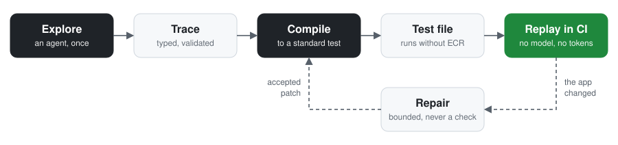

<p align="center">
  <picture>
    <source media="(prefers-color-scheme: dark)" srcset="assets/logo-dark.svg" />
    <source media="(prefers-color-scheme: light)" srcset="assets/logo-light.svg" />
    
  </picture>
</p>

<h1 align="center">Explore-Compile-Replay</h1>

<p align="center">
  An agent explores your app once. What it did becomes a standard test.<br />
  The test reruns in CI with no model.
</p>

<p align="center">
  <a href="https://github.com/pierridotite/explore-compile-replay/actions/workflows/ci.yml"></a>
  <a href="https://github.com/pierridotite/explore-compile-replay/stargazers"></a>
  <a href="LICENSE"></a>
  <a href="https://github.com/pierridotite/explore-compile-replay/commits/main"></a>
</p>

<p align="center">
  <a href="#quick-start"><b>Quick start</b></a>
  &nbsp;·&nbsp;
  <a href="docs/command.md">Documentation</a>
  &nbsp;·&nbsp;
  <a href="#paper-and-specification">Paper and specification</a>
  &nbsp;·&nbsp;
  <a href="CONTRIBUTING.md">Contributing</a>
  &nbsp;·&nbsp;
  <a href="CHANGELOG.md">Changelog</a>
</p>

<p align="center">
  <a href="https://www.linkedin.com/in/pierre-raffalli/"><picture><source media="(prefers-color-scheme: dark)" srcset="assets/linkedin-follow-dark.svg" /></picture></a>
  &nbsp;
  <a href="https://discord.gg/WuaCANscr8"><picture><source media="(prefers-color-scheme: dark)" srcset="assets/discord-join-dark.svg" /></picture></a>
  &nbsp;
  <a href="#paper-and-specification"><picture><source media="(prefers-color-scheme: dark)" srcset="assets/paper-dark.svg" /></picture></a>
</p>

<p align="center">
  <picture>
    <source media="(prefers-color-scheme: dark)" srcset="assets/how-it-works-dark.svg" />
    <source media="(prefers-color-scheme: light)" srcset="assets/how-it-works-light.svg" />
    
  </picture>
</p>

## About

AI agents are good at finding what nobody thought to test. They are also slow, they cost money on every run, and they never take the same path twice, so they do not fit in CI. Explore-Compile-Replay (ECR) keeps the first part and removes the rest: the agent runs once, and its path is kept as a plain test file that anyone can read, review and run.

> **Early draft, opened on 24 November 2026.** It runs end to end on a toy system and on a demo mobile app. No real app is supported yet: [where it stands](#where-it-stands).

## How it works

1. **Explore.** An agent plays a persona and uses the system once. Each action and each check is recorded in a typed trace.
2. **Compile.** The trace becomes a standard test file: a [Maestro](https://maestro.dev) flow for a mobile app today. It runs without ECR.
3. **Replay.** The file runs in CI. No model, no tokens, the same verdict every time.

When the app changes and a replay breaks on a step, your agent proposes a new action for that step, and a bounded **repair** accepts it or refuses it. A repair can change how a step finds its target. It can never change what the test checks.

A step of a trace, and what it compiles to:

```json
{
  "id": "s8",
  "action": { "kind": "tapOn", "target": { "text": "Save" } },
  "checkpoints": [
    { "id": "item-listed", "check": { "kind": "visible", "target": { "text": { "param": "ITEM_TITLE" } } } }
  ]
}
```

```yaml
# Step s8
- tapOn:
    text: "Save"
# Oracle item-listed
- assertVisible:
    text: "${ITEM_TITLE}"
```

The tap is stored by the name of the button, not by its place on the screen. The text that was typed is stored by its name, never by its value. The whole example: [the trace](packages/adapter-maestro/examples/anna-first-item-mobile.trace.json) and [the flow](packages/adapter-maestro/examples/anna-first-item-mobile.flow.yaml).

## Quick start

You need Node 22.18 or later and pnpm. Nothing is on npm yet: it runs from a clone.

```sh
git clone https://github.com/pierridotite/explore-compile-replay && cd explore-compile-replay
pnpm install
pnpm check     # types, tests and the conformance report

export ECR_PARAM_ITEM_TITLE="Buy bread" ECR_PARAM_PRIVATE_NOTE="Door code 4821"
pnpm ecr replay packages/adapter-fixture/examples/anna-first-item.trace.json \
  --adapter packages/adapter-fixture/src/index.ts
# pass  anna-first-item (node-test, 80 ms)
```

That replays a recorded trace against a to-do list in memory, the reference system. Validating, compiling, repairing and the report of the laws: [docs/command.md](docs/command.md).

## Where it is used

[mobile-agent-testers](https://github.com/pierridotite/mobile-agent-testers) gives one phone to each AI tester, on GitHub's runners, and each tester reports the bugs it finds. It is the first project that writes ECR traces:

- Each Android tester leaves its path as a trace, next to its report.
- With one option, the path is compiled and replayed on the same phone right after the agent, with no model.
- On its [map of the app's screens](https://pierridotite.github.io/mobile-agent-testers/), a finding of a tester becomes a check of the trace in two clicks.

So far this ran on its demo app, on an Android emulator. Of four paths explored by an agent, two stopped on a step, and two, of 37 and 25 steps, replayed in full with no model.

## A bug is a test too

A trace holds the bugs an agent found as checks: what should be true is recorded with `"observed": "failed"`, and it compiles to a test that is red until the bug is fixed. A replay gives one of four results.

| Result | Meaning |
|---|---|
| `pass` | Every check holds |
| `bug` | The replay stops on the bug the trace records, and on nothing else |
| `fixed` | The check that was recorded as a bug holds now. It becomes a guard |
| `FAIL` | Anything else: a step no longer finds its target, or a check that held no longer holds |

## Seven laws

An adapter connects ECR to one kind of system: a mobile app, a web app, an API. It is correct when it obeys seven laws, and a conformance kit checks them. Full text: [spec/laws.md](spec/laws.md). How to write one: [docs/adapter.md](docs/adapter.md).

| | Law | In short |
|---|---|---|
| L1 | Determinism | The same trace compiles to the same bytes. The same file gives the same verdict |
| L2 | Fidelity | The file runs the actions and the checks of the trace, in the same order |
| L3 | Traceability | Each step of the trace maps to one distinct range of the file |
| L4 | No model | Compiling and replaying call no model |
| L5 | State | A saved state, once restored, is observed as identical, when the adapter can save one |
| L6 | Safe repair | A patch stays inside the failing step, and removes or weakens no check |
| L7 | No secret | Neither the trace nor the file contains a secret value |

## Paper and specification

ECR is meant to be a standard that anyone can implement, not one tool. So it is written down, it can be checked, and it is being evaluated in the open.

- **The specification** is three files: the [trace format](spec/schema.ts), also published as a [JSON Schema](spec/trace.schema.json), the [adapter contract](spec/contract.ts) and the [seven laws](spec/laws.md). All three are drafts and can still change.
- **The conformance kit** checks an adapter against the laws and prints a report, law by law. An adapter that passes it conforms, whoever wrote it: [the report of the reference adapter](docs/command.md#check-your-clone).
- **A paper** describes the pattern, the contract and an evaluation on a real app, [LocalSend](https://github.com/localsend/localsend). It is being written, and no result is measured yet. Its [evaluation protocol](paper/protocol.md) was made public before the first measured run, and every later change to it is a dated amendment. The preprint will be published on Zenodo with the first release.
- **To cite this work**, use [CITATION.cff](CITATION.cff), or "Cite this repository" on the page of the repository. A DOI will come with the first release.

## Where it stands

| Status | What |
|---|---|
| **Works today** | The trace format, the contract and the laws, as drafts<br />The `ecr` command: `validate`, `compile`, `replay`, `repair`, `conformance`<br />A reference adapter, which the kit passes on L1, L2, L3, L5 and L7, on L4 with the network closed, and on part of L6<br />A mobile adapter that compiles to Maestro flows, replayed on an Android emulator against a demo app<br />A bounded repair, tried on the reference adapter |
| **In progress** | A real app: LocalSend is being tried now<br />The first release, with the preprint and a DOI |
| **Not yet** | iOS<br />A repair on a device<br />A package on npm |
| **Open to contributions** | A [web adapter](CONTRIBUTING.md#a-web-adapter-compiled-to-playwright-tests) that compiles to Playwright tests<br />An [MCP server](CONTRIBUTING.md#an-mcp-server-so-that-your-own-agent-explores-through-ecr), so that your own agent explores through ECR |

Part by part: [docs/status.md](docs/status.md).

## Where it comes from

ECR generalizes [mobile-agent-testers](https://github.com/pierridotite/mobile-agent-testers). Two of its runs never take the same path, so when a tester finds a bug, the path that led to it is worth keeping, as a test that runs for free.

The shape of the idea comes from [Remotion](https://www.remotion.dev), where a video is code: an AI writes that code once, and every render gives the same video with no model. ECR does the same for tests: the agent explores once, and the replay is the render.

<details>
<summary>ECR does not claim to be first: the tools that came before</summary>

Several tools already keep or replay what an agent did, each for its own system: [Stagehand](https://github.com/browserbase/stagehand), [Skyvern](https://github.com/Skyvern-AI/skyvern), [workflow-use](https://github.com/browser-use/workflow-use), [Midscene](https://github.com/web-infra-dev/midscene), [Arbigent](https://github.com/takahirom/arbigent), [muscle-mem](https://github.com/pig-dot-dev/muscle-mem) and [autocompile](https://github.com/mirkokiefer/autocompile). What this project adds is a name for the pattern and a written contract for it: one that works across systems, compiles to files that run without the tool, protects what the tests check, and can be verified by a conformance kit.

</details>

## Contributing

The contract is the thing to challenge right now. If you maintain a test tool or an agent framework, or if you would write an adapter, [open an issue](https://github.com/pierridotite/explore-compile-replay/issues/new) and say what would not fit your system.

To write code, the [contributing guide](CONTRIBUTING.md) lists two large pieces that are open, a web adapter and an MCP server, and smaller tasks to start with.

## Author

<p align="center">
  Made by <a href="https://github.com/pierridotite">Pierre Raffalli</a>. To follow the work as it happens, or to talk it through:
</p>

<p align="center">
  <a href="https://www.linkedin.com/in/pierre-raffalli/"><picture><source media="(prefers-color-scheme: dark)" srcset="assets/linkedin-follow-dark.svg" /></picture></a>
  &nbsp;
  <a href="https://discord.gg/WuaCANscr8"><picture><source media="(prefers-color-scheme: dark)" srcset="assets/discord-join-dark.svg" /></picture></a>
</p>

<p align="center"><sub>The Discord is shared with mobile-agent-testers.</sub></p>

## License

[Apache-2.0](LICENSE)
